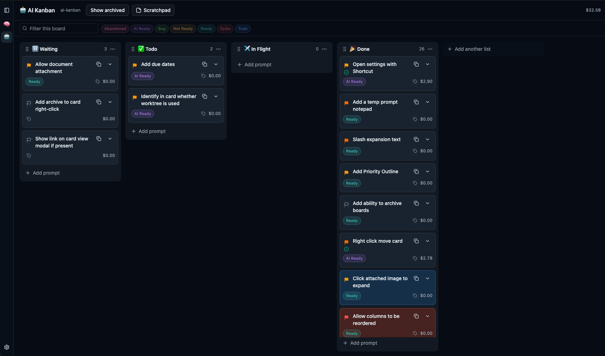

# AI Kanban

A local desktop Kanban board for prompt work. Each card is a prompt you can organize, copy, and hand to a Claude coding agent. Boards, lists, and cards live in a JSON file on your machine. Nothing is synced to a server.

The board works on its own. Running an agent needs a signed-in [Claude Code](https://docs.anthropic.com/en/docs/claude-code) install.



## Features

**Boards.** Multiple boards, each with reorderable lists. Drag cards between lists, filter the board, and search every card with ⌘K. Archive a board or a card when you want it out of the way. Archived boards stay in the file and can be restored from Settings.

**Cards.** A card holds a title, prompt, notes, link, tags, priority, and color. `{{variables}}` in a prompt are filled in when you copy it. Paste or upload images on the card. Click a thumbnail to see the full image. Images are stored next to the data file, not inside the JSON.

**Agents.** Run a card against a repository. The session continues in a background daemon, so it keeps going if you quit the app, and the card reattaches when you come back. Watch the transcript, reply, and approve or deny tool use. A board can set a default repo and model. A card can override both. Usage cost is shown on the card and the board.

**Worktrees and Ship.** Turn on “Run cards in git worktrees” and each run gets its own worktree, so several cards can work in one repo at the same time. Ship merges that work back onto a branch in your real checkout. Conflicts are resolved inside the worktree.

**Scratchpad and snippets.** Every board has its own scratchpad (⌘⇧P) for notes that save as you type. Settings (⌘⇧S) holds a library of slash snippets. Typing `/grill-me` in a card prompt expands to the text you stored for that command.

## Requirements

- Node.js 22 (the version CI uses)
- npm 7 or newer
- Claude Code, signed in, to run agent sessions
- Git, to use worktrees and Ship

Packaged builds target macOS (Apple silicon and Intel), Windows (NSIS), and Linux (AppImage).

## Develop

```bash
npm install
npm start
```

The first install compiles a webpack DLL, so it takes longer than a normal install. `npm start` launches Electron with a hot-reloading renderer.

| Command | What it does |
| --- | --- |
| `npm start` | Run the app in development |
| `npm test` | Run the Jest suite |
| `npm run lint` | Lint the project |
| `npx tsc --noEmit` | Typecheck |
| `npm run package` | Build installers into `release/build` |

`npm test` does not call the Claude API. Agent behavior is covered with mocks.

## Using the app

On first launch, choose where the board file lives. **Use default location** creates `~/Documents/ai-kanban/kanban.json` and seeds one board with Waiting, In Flight, and Done. You can also pick another path or open a file you already have.

Settings covers the data file (move, backup, open another file, recent files), agent sessions (worktrees, tool approval, default model, notification sounds, restart daemon), tags, boards (including unarchive), and snippets.

### Shortcuts

On Windows and Linux, use Ctrl where the table says ⌘.

| Shortcut | Action |
| --- | --- |
| ⌘Z | Undo |
| ⌘⇧Z | Redo |
| ⌘N | New card |
| ⌘B | Toggle the sidebar |
| ⌘⌥↑ / ⌘⌥↓ | Switch board |
| ⌘K | Search cards |
| ⌘⇧P | Open this board’s scratchpad |
| ⌘⇧S | Open settings |
| ⌘? | Show keyboard shortcuts |
| ⌘⏎ | Save the card you are editing |

⌘? is the `/` key with Shift. On macOS that keystroke arrives as `/`, and the app treats it as `?`.

### Where files live

| What | Where |
| --- | --- |
| Board document | The path you chose. Default: `~/Documents/ai-kanban/kanban.json` |
| Card images | A sibling folder, `kanban.assets/`, next to that file |
| App settings | `settings.json` in the app’s user-data directory |
| Session daemon, usage ledger, worktrees | The same user-data directory |

On macOS the user-data directory is `~/Library/Application Support/ai-kanban`. On Windows it is `%APPDATA%\ai-kanban`. On Linux it is `~/.config/ai-kanban`.

The board file is pretty-printed JSON, schema version 1. Writes are atomic: the app writes a temp file beside the real one and renames it into place. If you edit the file in another program, the app asks whether to reload it or keep the copy you have open. It will not overwrite a file it could not parse.

The session daemon is a separate process and keeps running after you quit. To stop it yourself:

```bash
kill "$(cat "$HOME/Library/Application Support/ai-kanban/session-daemon.pid")"
```

Settings also has **Restart Daemon** if a card’s session looks stuck.

## Project layout

```
src/renderer   React UI and the Zustand document store
src/main       Electron main process: files, settings, git, Ship, daemon client
src/main/daemon  Claude Agent SDK process
src/shared     Zod schema and IPC types shared by both processes
src/__tests__  Jest tests
.erb           Webpack and Electron packaging scripts
```

The renderer owns the document. The main process reads and writes the file, watches it for outside edits, and talks to the daemon. The daemon never writes `kanban.json`. Live session state stays out of the board file. What does get saved on a card is the session id, repo, model, and, when worktrees are on, the worktree path and branch.

## License

MIT. See [LICENSE](LICENSE).
